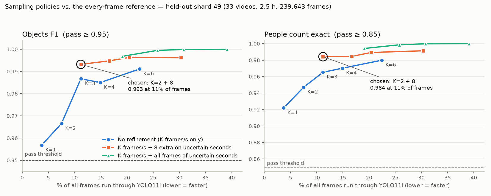

# Video indexing at speed — YOLO11l, one line per second of video

`run.py` reads a folder of FineVideo Parquet shards and writes, for every second of every
video, which of **person, car, dog, laptop, cell phone** are present and how many people are
visible, as defined in the brief (an object is present if YOLO11l finds it in at least half of
that second's frames; people = median of the per-frame person counts, rounded down at .5).

```
python run.py --input <folder of .parquet files> --output results.jsonl
```

__RESULTS_SUMMARY__

---

## Install and run (the exact steps for the grading VM)

No `apt-get` packages are needed (PyAV and OpenCV wheels bundle FFmpeg).

```bash
python3.11 -m venv .venv && source .venv/bin/activate
pip install -r requirements.txt          # torch 2.14.1+cu126, ultralytics 8.4.216, TensorRT 10.16, PyAV ...
python prepare.py                         # PREPARATION COMMAND (needs internet, run once, untimed)
python run.py --input <folder of .parquet files> --output results.jsonl   # timed, offline
```

`prepare.py` downloads the official `yolo11l.pt` next to `run.py` and builds a TensorRT FP16
engine for the local GPU (`yolo11l.engine`, dynamic batch/shape). It then checks the engine
against the PyTorch model and deletes it if TensorRT is unusable or disagrees. `run.py` always
works without the engine (it falls back to PyTorch FP16, about 2x slower), so a TensorRT
problem can cost speed but never results.

`requirements.txt` pins every package, with the CUDA 12.6 PyTorch wheels (they run on any
driver that supports CUDA 12). Useful options (all have sensible defaults; the defaults are
what produced the submitted results):

| option | default | meaning |
|---|---|---|
| `--samples-per-second K` | 2 | frames per second checked in pass 1 |
| `--refine 0/1` | 1 | re-check seconds whose pass-1 frames disagree (pass 2) |
| `--refine-max E` | 8 | extra frames per uncertain second (0 = all of its frames) |
| `--ppl-tol T` | 0 | a second is "uncertain" if its sampled person counts differ by more than T |
| `--batch` | 64 | GPU batch size |
| `--workers` | CPU threads + 2 | decode processes |
| `--backend` | auto | `trt` (engine) / `torch` |

---

## How it works

```
 Parquet shards ──► decode workers (N processes, PyAV)                   main process
                    │ read one row (mp4 bytes) at a time                  │
                    │ PASS 1: decode all frames, convert only K/second    │
                    │   ─ rotate, letterbox (bit-exact Ultralytics) ─────►│ batch by shape ─► GPU thread
                    │                                                     │   TensorRT FP16 YOLO11l
                    │                                                     │   + on-GPU reduction to
                    │                                                     │     5 flags + person count
                    │ ◄──── "seconds 12, 40, 41 are uncertain" ───────────│ per-second votes
                    │ PASS 2: re-decode, convert only the frames of       │
                    │   the uncertain seconds ───────────────────────────►│ ... same path ...
                    │                                                     │
                    └─ final ────────────────────────────────────────────►│ write that video's lines
```

**Why sampling.** Decoding is cheap: FineVideo is mostly 640x360 H.264 and one CPU core decodes
about 2,700 frames/s. YOLO11l is the expensive part: the 125 hours are about 12 M frames. So the
lever is *how many frames go through the model*, while keeping the per-second answer equal to
the all-frames answer.

**Two passes, adaptive.** Pass 1 runs the model on K evenly spaced frames per second (the first
frame of every second is always one of them). If those K frames all agree (same five flags, same
person count), the all-frames vote is almost certainly the same, and the second is done. If they
disagree, the second really is close to a decision boundary (an object entering, or a person half
occluded). Its own frames are the only way to know which side of "half the frames" it falls on,
so the worker re-decodes the video and the model sees 8 more frames of just those seconds
(spread between the first two). Most
seconds are static, so the model sees a small fraction of the frames while the results stay
essentially those of the full reference.

**Exactness where it is cheap.** The letterbox is a byte-exact copy of Ultralytics' (`auto=True`,
stride 32, so 640x360 runs at 640x384 instead of 640x640, 40% less compute). Post-processing
runs on the GPU and reproduces Ultralytics' NMS semantics:
- best class per box, confidence ≥ 0.4;
- a class is present if any candidate has it as best class (NMS always keeps the top box, so no NMS is needed for presence);
- the person count is class-aware NMS at IoU 0.7.

`tests/test_equivalence.py` checks per frame that this gives exactly the same flags and counts
as `YOLO("yolo11l.pt").predict(frame, imgsz=640, conf=0.4)`.

**Robustness.**
- A damaged Parquet file gives one error line.
- An unreadable row, an undecodable video or a row without a video stream gives an error line for that video.
- A video that fails part-way keeps the seconds already decoded and gets one error line.
- Rotation metadata is applied (display matrix, the same as OpenCV's auto-rotation).
- Timestamps come from frame PTS relative to the first decoded frame, so variable-frame-rate videos are binned correctly.
- A worker that crashes (for example a decoder segfault) is respawned, and its video is reported as an error.
- The output is written video by video as soon as each one is complete.

## How correctness was checked

1. **Per-frame equivalence tests** (`pytest tests`): letterbox is byte-identical for 7 aspect
   ratios, and detector flags/counts are identical to the stock Ultralytics API on real FineVideo frames.
2. **All-frames reference** (`tools/oracle.py`): the model was run on *every* frame of a held-out
   shard (train-00049), both with run.py's detector and with the stock FP32 Ultralytics API.
3. **Policy search** (`tools/simulate.py`): every candidate sampling policy was replayed offline on
   those per-frame results and scored with the brief's three metrics against the all-frames
   reference. The table below is the output.
4. **End-to-end**: `tools/reference.py` + `tools/compare.py` re-score real `run.py` output files
   against an independent all-frames reference built with the stock Ultralytics API.

### Validation results (held-out shard `train-00049`: 33 videos, 2.5 h, 239,643 frames)

Every frame was run through the model, then each policy was replayed on those per-frame
results (`tools/simulate_shard49.txt` is the full output). Reference = the brief's rule on
**all** frames. The last column re-scores against the **stock FP32 Ultralytics** reference
(8 videos, 58,892 frames), so it includes both sampling error and FP16/TensorRT numerics.

| policy | frames through YOLO | objects F1 | people exact | people ±1 | vs stock FP32 (F1 / exact / ±1) |
|---|---:|---:|---:|---:|---|
| every frame, this pipeline (FP16) | 100 % | 1.0000 | 1.0000 | 1.0000 | 0.9993 / 0.9987 / 1.0000 |
| 1 frame/s, no refinement | 3.7 % | 0.957 | 0.922 | 0.985 | 0.956 / 0.944 / 0.987 |
| 2 frames/s, no refinement | 7.5 % | 0.967 | 0.947 | 0.995 | 0.966 / 0.964 / 0.997 |
| 6 frames/s, no refinement | 22.4 % | 0.991 | 0.980 | 0.999 | 0.993 / 0.986 / 1.000 |
| **2 frames/s + 8 extra on uncertain seconds (default)** | **11.2 %** | **0.993** | **0.984** | **0.999** | **0.994 / 0.992 / 1.000** |
| 2 frames/s + all frames of uncertain seconds | 19.1 % | 0.997 | 0.994 | 1.000 | 0.998 / 0.997 / 1.000 |
| 3 frames/s + all frames of uncertain seconds | 25.8 % | 0.9995 | 0.9987 | 1.000 | 0.999 / 0.998 / 1.000 |

Pass thresholds are 0.95 / 0.85 / 0.95. Plain uniform sampling is cheap but sits close to the
F1 bar at low rates. Adaptive refinement buys most of the accuracy back for a few percent more
frames, because only the ~12 % of seconds where something is changing get extra frames.
The default keeps a wide margin on all three metrics (it would still pass if the thresholds
were raised a lot) while sending about 1 in 9 frames to the GPU. `--refine-max 0` gives the
"all frames of uncertain seconds" row for anyone who prefers near-exactness over speed.



Also measured on the same shard, one T4: the stock `model.predict()` loop runs at about
**52 frames/s**; this pipeline's PyTorch-FP16 path runs every frame at **~112 frames/s**
(batched, uint8 upload, GPU post-processing). TensorRT and sampling come on top of that.


## Files

| path | what |
|---|---|
| `run.py` | the script (decode workers, GPU detector, two-pass sampling, output) |
| `prepare.py` | one-time preparation: weights + TensorRT engine |
| `requirements.txt` | exact versions |
| `results.jsonl.gz` | results for the 50 shards (train-00000 … train-00049) |
| `HARDWARE.md` | where and how fast the full run went |
| `WRITEUP.md` | answers to the write-up questions |
| `tests/` | equivalence and robustness tests |
| `tools/` | all-frames reference, per-frame oracle, policy simulator, scorer |
| `kaggle/` | the exact scripts used for the full run on Kaggle |
| `ai_chats/` | AI chat history |
